<div align="center">
  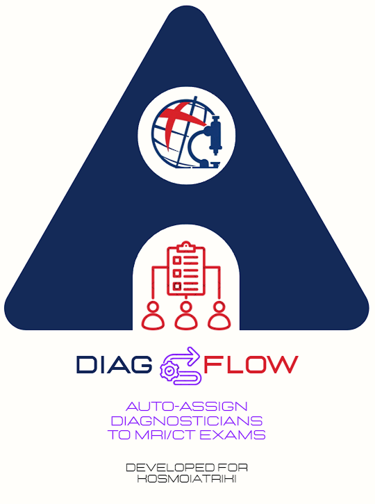
</div>

# 📘 DiagFlow — Οδηγός Χρήστη

## 📋 Περιεχόμενα

- [🏥 Τι είναι το DiagFlow;](#-τι-είναι-το-diagflow)
- [🔄 Πώς λειτουργεί η ροή ανάθεσης;](#-πώς-λειτουργεί-η-ροή-ανάθεσης)
- [🖥️ Το Dashboard — Κύρια Οθόνη](#️-το-dashboard--κύρια-οθόνη)
  - [📋 Καρτέλα Εκκρεμών Εξετάσεων](#καρτέλα-εκκρεμών-εξετάσεων)
  - [📊Το παράθυρο πρότασης](#το-παράθυρο-πρότασης)
  - [✔️ Ομαδικές Ενέργειες & Πολλαπλή Επιλογή](#ομαδικές-ενέργειες--πολλαπλή-επιλογή)
- [✅ Καρτέλα Ανατεθειμένων Εξετάσεων](#-καρτέλα-ανατεθειμένων-εξετάσεων)
  - [📩 Αποστολή στο Slis](#αποστολή-στο-slis)
- [🔍 4η Καρτέλα: Αναζήτηση Slis & Επανάθεση Εξετάσεων](#-4η-καρτέλα-αναζήτηση-slis--επανάθεση-εξετάσεων)
- [🔐 Το Admin Panel](#-το-admin-panel)
  - [🔑 Είσοδος στο Admin Panel](#είσοδος-στο-admin-panel)
  - [🏥 Πρόγραμμα Παμμακαρίστου](#-πρόγραμμα-παμμακαρίστου)
  - [👨‍⚕️ Διαχείριση Διαγνωστών](#️-διαχείριση-διαγνωστών)
  - [🌴 Ημερολόγιο Διαθεσιμότητας](#-ημερολόγιο-διαθεσιμότητας)
  - [📋 Κατάλογος Εξετάσεων & Ομαδικές Δεξιότητες](#-κατάλογος-εξετάσεων--ομαδικές-δεξιότητες)
  - [🎯 Εξειδικεύσεις Διαγνωστών](#-εξειδικεύσεις-διαγνωστών)
  - [🤝 Συνεργασίες Γιατρών](#-συνεργασίες-γιατρών)
  - [⚙️ Προχωρημένες Ρυθμίσεις](#️-προχωρημένες-ρυθμίσεις)
- [❓ Συχνές Ερωτήσεις](#-συχνές-ερωτήσεις)

---

## 🏥 Τι είναι το DiagFlow;

Το **DiagFlow** είναι μια εφαρμογή που βοηθά τη γραμματεία να **αναθέτει ιατρικές εξετάσεις CT και MRI σε διαγνωστές** γρήγορα και έξυπνα.

Κάθε μέρα φτάνουν στο σύστημα εκκρεμείς εξετάσεις από το Slis (το σύστημα του διαγνωστικού κέντρου). Το DiagFlow αναλύει αυτόματα κάθε εξέταση και προτείνει τον καταλληλότερο διαγνωστή, λαμβάνοντας υπόψη:

- ✅ Αν ο διαγνωστής **εργάζεται σήμερα** και δεν είναι σε άδεια
- ✅ Αν **δεν έχει υπερβεί** το ημερήσιο όριο εξετάσεων
- ✅ Αν **έχει εξειδίκευση** στη συγκεκριμένη εξέταση
- ✅ Αν **υπάρχει συνεργασία** με τον γιατρό που παρέπεμψε
- ✅ Αν **έχει εξετάσει τον ασθενή** στο παρελθόν
- ✅ Αν δουλεύει στο **κατάλληλο εργαστήριο**

> 💡 **Σημαντικό:** Το DiagFlow **προτείνει**, δεν αποφασίζει. Η τελική απόφαση παραμένει πάντα στον χειριστή της γραμματείας. Μπορείτε να αποδεχτείτε ή να αλλάξετε κάθε πρόταση.

> 🌐 **Ταυτόχρονη Χρήση από Πολλαπλούς Υπολογιστές:** Το DiagFlow υποστηρίζει πλήρως την ταυτόχρονη εκτέλεση σε πολλαπλούς υπολογιστές γραμματείας. Όλες οι ρυθμίσεις διαχειριστή, οι διαθεσιμότητες, οι προσωρινές αναθέσεις και τα ημερήσια όρια συγχρονίζονται απευθείας και σε πραγματικό χρόνο μέσω της κεντρικής βάσης δεδομένων.

---

## 🔄 Πώς λειτουργεί η ροή ανάθεσης;

> 💡 **Ομαδοποίηση βάσει Εντολής (`extracode`):** Όταν μια παραγγελία/εντολή περιλαμβάνει πολλαπλές εξετάσεις για τον ίδιο ασθενή (με τον ίδιο κωδικό Εντολής/extracode), η μηχανή κανόνων εξασφαλίζει ότι προτείνεται **ο ίδιος διαγνώστης για όλες τις εξετάσεις της εντολής**, διασφαλίζοντας την ιατρική και διαγνωστική συνοχή.

Παρακάτω περιγράφεται βήμα-βήμα η ροή από τη στιγμή που φτάνει μια εξέταση μέχρι να σταλεί πίσω στο Slis:

```
1. ΑΝΤΛΗΣΗ ΕΞΕΤΑΣΕΩΝ
   └─ Πατάτε "Ανανέωση" στο dashboard
      └─ Το σύστημα τραβά νέες εξετάσεις από το Slis (τελευταίες 3 ημέρες)
      └─ Αυτόματες αναθέσεις γίνονται αμέσως (αποκλειστικές συνεργασίες, Παμμακάριστος κ.λπ.)

2. ΠΡΟΒΟΛΗ ΠΡΟΤΑΣΗΣ & ΑΝΑΛΥΣΗΣ
   └─ Οι προτάσεις παράγονται αυτόματα για όλες τις εμφανιζόμενες εξετάσεις
   └─ Πατάτε "Προβολή" (View) δίπλα σε μια εξέταση στην καρτέλα "Εκκρεμείς"
   └─ Βλέπετε την πρόταση, το score που μάζεψε και τις διαθέσιμες εναλλακτικές

3. ΕΠΙΒΕΒΑΙΩΣΗ Ή ΠΑΡΑΚΑΜΨΗ
   └─ Αποδέχεστε την πρόταση (Επιβεβαίωση) ή
      └─ Επιλέγετε άλλο διαγνωστή (Παράκαμψη / Override)

4. ΑΠΟΣΤΟΛΗ ΣΤΟ SLIS
   └─ Από την καρτέλα "Ανατεθειμένες" πατάτε "Αποστολή στο Slis"
      └─ Η ανάθεση ενημερώνεται στο κεντρικό σύστημα Slis
```

<div align="center">

| Συνολική Ροή Ανάθεσης |
|:---:|
| 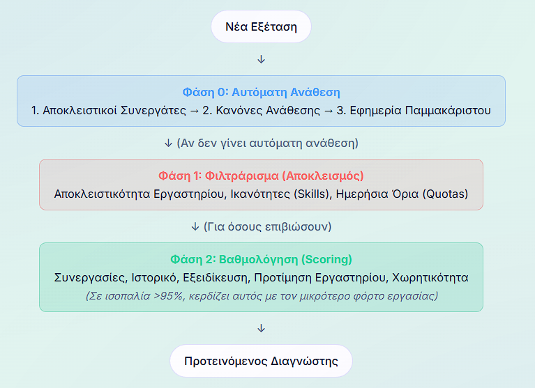 |

</div>

---

## 🖥️ Το Dashboard — Κύρια Οθόνη

Μόλις ανοίξετε την εφαρμογή, βλέπετε το **Dashboard** — την κύρια οθόνη εργασίας. Διαθέτει 4 καρτέλες:

- **Εκκρεμείς** — Εξετάσεις που δεν έχουν ανατεθεί ακόμα
- **Ανατεθειμένες** — Εξετάσεις που έχουν ανατεθεί τοπικά και περιμένουν αποστολή στο Slis
- **Dashboard** — Ζωντανή επισκόπηση ορίων, υπολοίπου χωρητικότητας και κατανομής CT/MRI ανά διαγνωστή
- **Αναζήτηση Slis** — Απευθείας αναζήτηση στη βάση Slis, παρακολούθηση κατάστασης συγχρονισμού και διαδραστική επανατοποθέτηση διαγνωστή με έλεγχο εξειδικεύσεων σε πραγματικό χρόνο

<div align="center">

| Αρχική Οθόνη (Καρτέλα Εκκρεμών — Bright Mode) | Αρχική Οθόνη (Καρτέλα Εκκρεμών — Dark Mode) |
|:---:|:---:|
| 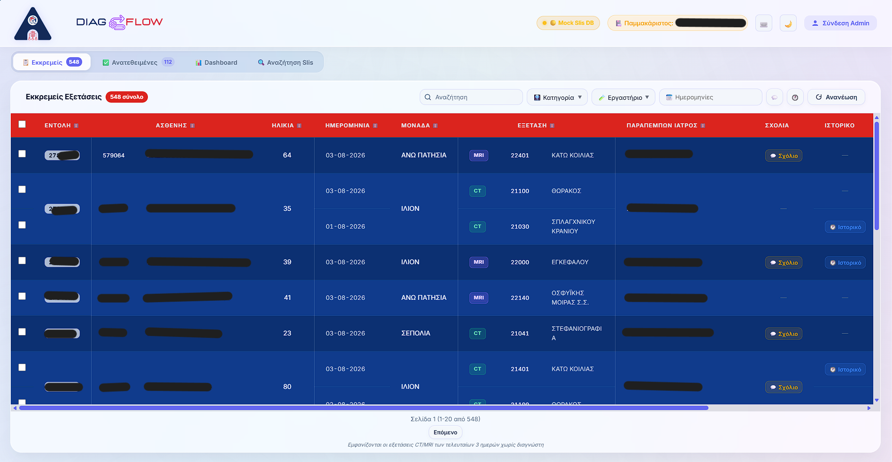 | 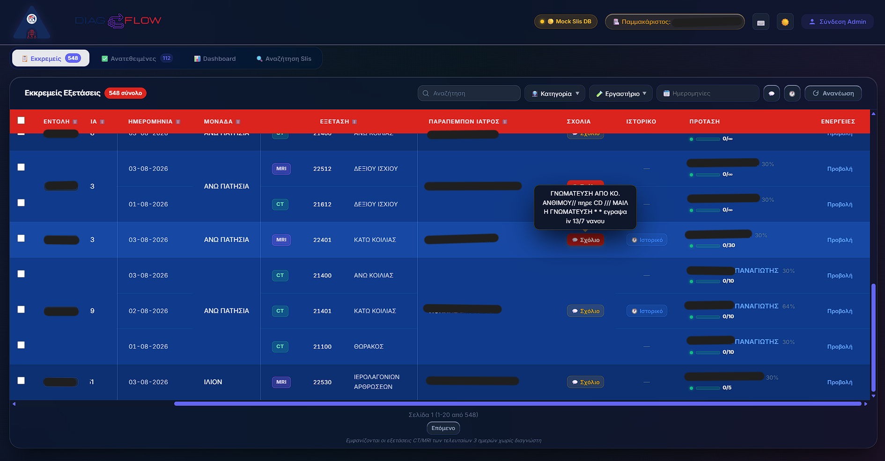 |

| Επισκόπηση Dashboard & Κατανομή Modality |
|:---:|
| 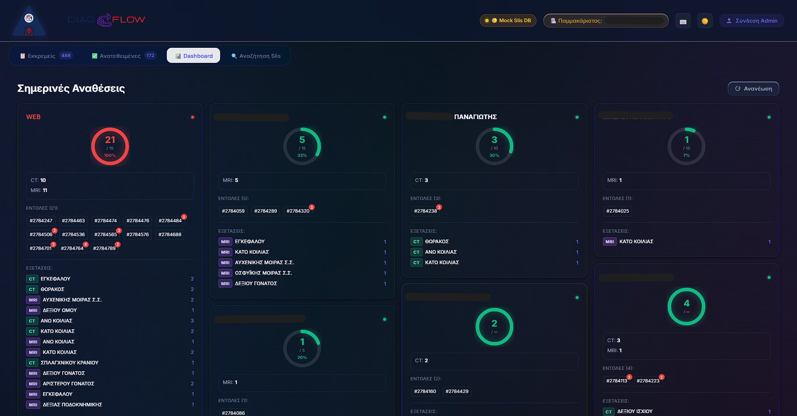 |

</div>

---

### Καρτέλα Εκκρεμών Εξετάσεων

Στον πίνακα των εκκρεμών εξετάσεων βλέπετε για κάθε εξέταση:

| Στήλη | Τι σημαίνει |
|-------|------------|
| **Κωδικός εξέτασης** | Ο μοναδικός αριθμός αναγνώρισης της εξέτασης |
| **Ασθενής** | Στοιχεία ασθενή (επίσκεψη, ημερομηνία) |
| **Ηλικία** | Ηλικία του ασθενούς |
| **Τύπος** | CT, MRI κ.λπ. |
| **Εργαστήριο** | Από ποιο εργαστήριο/κλινική |
| **Γιατρός** | Ο γιατρός που παρέπεμψε |
| **Κατάσταση** | Εκκρεμής / Έχει πρόταση |

Μπορείτε να **φιλτράρετε** τις εξετάσεις ανά τύπο, εργαστήριο ή ημερομηνία ή μόνο αυτές που έχουν σχόλια ή και ιστορικό:

<div align="center">

| Φιλτράρισμα & Αναζήτηση |
|:---:|
| 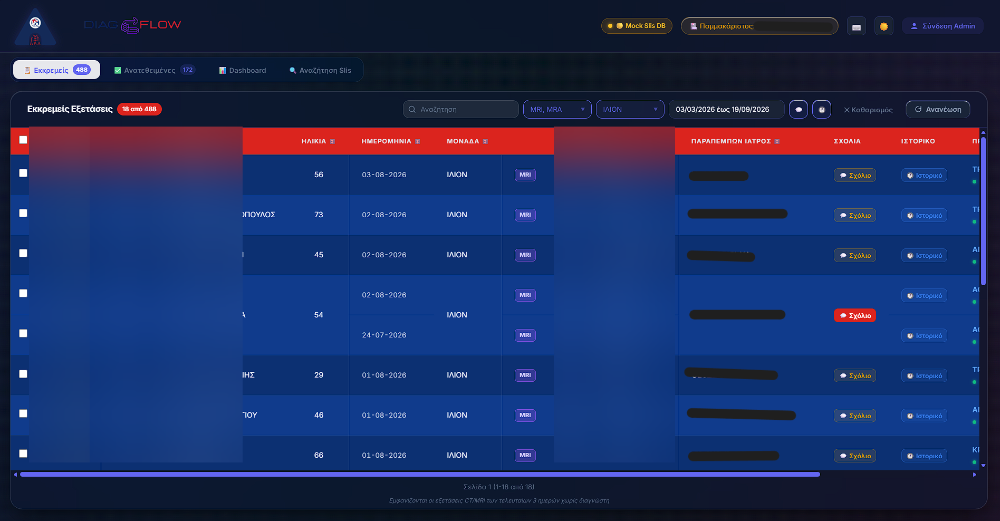 |

</div>

---

### Το παράθυρο πρότασης

1. **Με το που φορτώνει η σελίδα**, το σύστημα παράγει αυτόματα προτάσεις ανάθεσης για όλες τις γραμμές εξετάσεων που εμφανίζονται.
2. Πατήστε το κουμπί **"Προβολή"** (View) δίπλα στην εξέταση που σας ενδιαφέρει.
3. Εμφανίζεται το παράθυρο με την πρόταση του συστήματος, τη βαθμολογία (score) που μάζεψε και τις εναλλακτικές επιλογές.

Όταν πατήσετε "Προβολή", εμφανίζεται ένα παράθυρο με:

- **Όνομα προτεινόμενου διαγνωστή** — Ποιος θα αναλάβει την εξέταση
- **Βαθμολογία** — Πόσο κατάλληλος είναι (0–100%)
- **Ανάλυση λόγων** — Γιατί προτείνεται αυτός ο διαγνωστής (π.χ. "Συνεργασία με γιατρό", "Ιστορικό ασθενή")
- **Κουμπί Επιβεβαίωσης** — Για να αποδεχτείτε την πρόταση
- **Κουμπί Εναλλακτικών** — Για να δείτε και άλλες επιλογές

<div align="center">

| Ανάλυση Συστήματος Βαθμολόγησης | Λεπτομέρεια Βαθμολογίας |
|:---:|:---:|
| 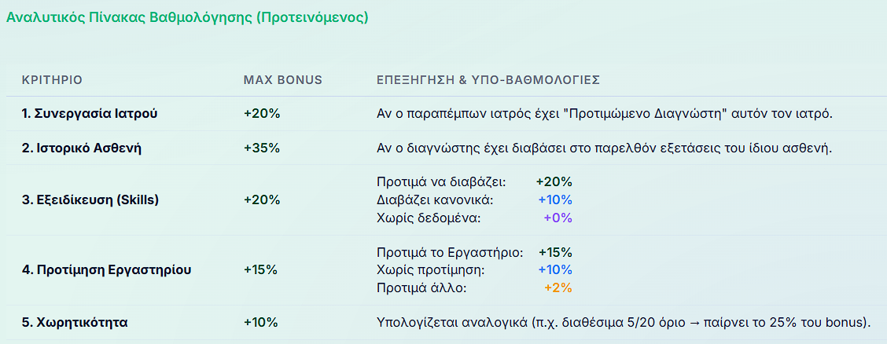 | 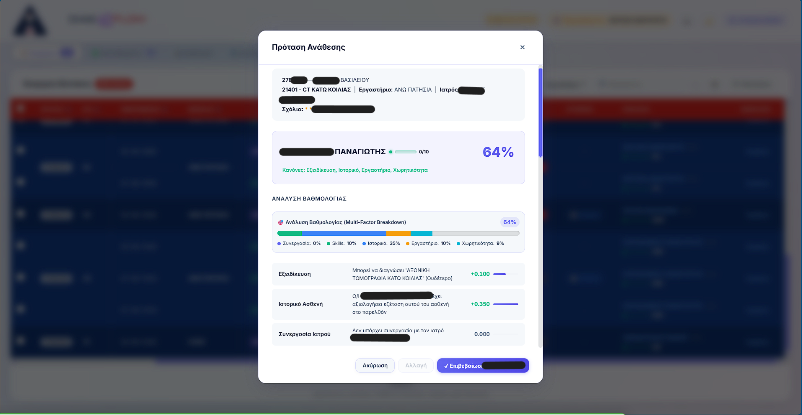 |

</div>

**Τι σημαίνουν οι παράγοντες βαθμολόγησης;**

| Παράγοντας | Τι ελέγχει | Ποσοστό |
|-----------|------------|---------|
| 🤝 **Συνεργασία Γιατρού** | Αν ο διαγνωστής έχει ενεργή συνεργασία με τον γιατρό που παρέπεμψε | 35% |
| 📋 **Ιστορικό Ασθενή** | Αν ο ίδιος διαγνωστής έχει εξετάσει τον ασθενή στο παρελθόν | 20% |
| 🎓 **Εξειδίκευση** | Αν ο διαγνωστής έχει ειδική εκπαίδευση σε αυτόν τον τύπο εξέτασης | 20% |
| 🏥 **Εργαστήριο** | Αν το εργαστήριο ταιριάζει με την προτίμηση του διαγνωστή | 15% |
| 📊 **Χωρητικότητα** | Πόσες εξετάσεις έχει ήδη σήμερα (λιγότερες = καλύτερο) | 10% |

Επίσης εμφανίζεται λίστα με **εναλλακτικούς διαγνώστες**:

- **Χωρίς χρώμα** — Διαγνωστές που είναι κατάλληλοι και διαθέσιμοι
- **Κόκκινο** — Διαγνωστές που **δεν** μπορούν να αναλάβουν την εξέταση (με εξήγηση)

Ακόμα και αν ένας διαγνώστης είναι "κόκκινος" (αποκλεισμένος), μπορείτε **χειροκίνητα να επιλέξετε** αυτόν αν χρειάζεται, παρακάμπτοντας τον κανόνα.

<div align="center">

| Παράθυρο Εναλλακτικών Επιλογών |
|:---:|
| 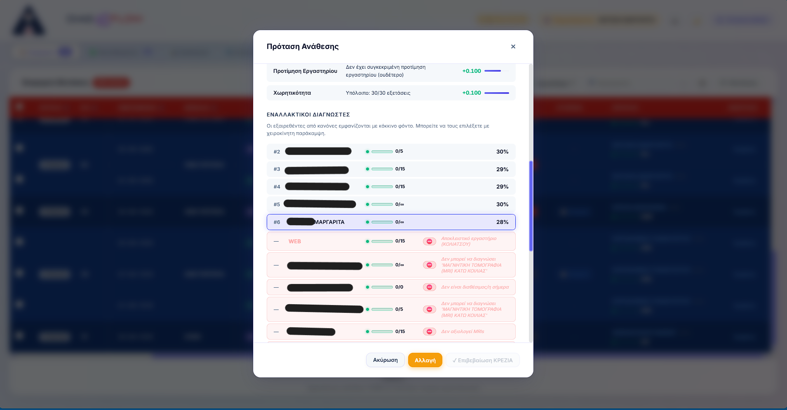 |

</div>

**Παραδείγματα λόγων αποκλεισμού:**

| Λόγος | Τι σημαίνει |
|-------|------------|
| `Σε άδεια` | Ο διαγνωστής έχει δηλωμένη άδεια σήμερα |
| `Εκτός προγράμματος` | Δεν εργάζεται αυτή την ημέρα της εβδομάδας |
| `Έχει συμπληρώσει το ημερήσιο όριο (15/15)` | Έχει φτάσει τον μέγιστο αριθμό εξετάσεων για σήμερα |
| `Δεν αναλαμβάνει CT` | Δεν έχει δυνατότητα CT |
| `Αποκλειστικό εργαστήριο` | Ανήκει αποκλειστικά σε άλλο εργαστήριο |

---

### Ομαδικές Ενέργειες & Πολλαπλή Επιλογή

Μπορείτε να επιλέξετε **πολλές εξετάσεις ταυτόχρονα** τσεκάροντας τα πλαίσια επιλογής, χρησιμοποιώντας <kbd>Shift + Click</kbd> για μαζική επιλογή εύρους:

- **Ομαδική Επιβεβαίωση** — Επιβεβαιώνει τις ήδη υπάρχουσες προτάσεις για όλες τις επιλεγμένες εξετάσεις
- **Ομαδική Παράκαμψη** — Αναθέτει όλες τις επιλεγμένες εξετάσεις σε έναν συγκεκριμένο διαγνωστή
- **Floating Action Bar** — Μόλις επιλεγεί τουλάχιστον μία εξέταση, εμφανίζεται στο κάτω μέρος της οθόνης η μπάρα ενεργειών για άμεση εκτέλεση μαζικών αναθέσεων

<div align="center">

| Πολλαπλή Επιλογή & Μπάρα Ενεργειών |
|:---:|
| 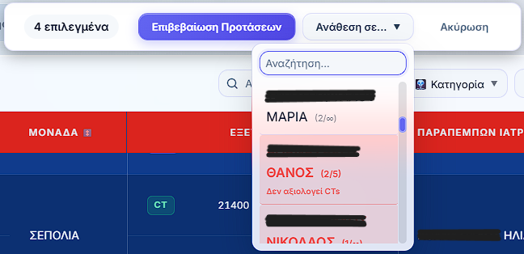 |

</div>

---

## ✅ Καρτέλα Ανατεθειμένων Εξετάσεων

Η καρτέλα **"Ανατεθειμένες"** δείχνει όλες τις εξετάσεις που έχουν ήδη ανατεθεί τοπικά αλλά **δεν έχουν σταλεί ακόμα στο Slis**.

Κάθε εξέταση εμφανίζεται με:

- **Όνομα διαγνωστή** που ανέλαβε
- **Ετικέτα `AUTO`** — Αν η ανάθεση έγινε αυτόματα (π.χ. αποκλειστική συνεργασία ή Παμμακάριστος)
- **Λόγος αυτόματης ανάθεσης** — Π.χ. "Αποκλειστική συνεργασία ΓΙΑΤΡΟΣ Α → ΔΙΑΓΝΩΣΤΗΣ Β"

<div align="center">

| Αυτόματη Ανάθεση (Καρτέλα Ανατεθέντων) |
|:---:|
| 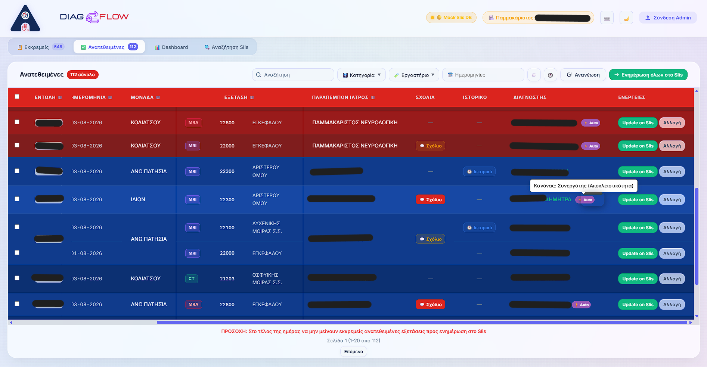 |

</div>

---

### Αποστολή στο Slis

Όταν είστε ικανοποιημένοι με τις αναθέσεις, πατήστε **"Αποστολή στο Slis"** για να ενημερωθεί το κεντρικό σύστημα.

Μπορείτε να:
- **Στείλετε όλες** τις ανατεθειμένες εξετάσεις ταυτόχρονα
- **Επιλέξετε συγκεκριμένες** εξετάσεις και να τις στείλετε μεμονωμένα

> ⚠️ **Σημείωση:** Μέχρι να πατήσετε "Αποστολή στο Slis", οι αναθέσεις αποθηκεύονται **μόνο τοπικά** στο DiagFlow και σε όσους άλλους το χρησιμοποιούν και δεν φαίνονται στο Slis.

---

## 🔍 4η Καρτέλα: Αναζήτηση Slis & Επανάθεση Εξετάσεων

Στην 4η καρτέλα (**"🔍 Αναζήτηση Slis"**) μπορείτε να πραγματοποιήσετε απευθείας αναζήτηση εξετάσεων στη βάση δεδομένων του Slis και να αλλάξετε την ανάθεση διαγνώστη που έγινε από το σύστημα ή το χρήστη.

### Πεδία Αναζήτησης

- **📆 Εύρος Ημερομηνιών:** Προεπιλεγμένα αναζητά εξετάσεις των **τελευταίων 7 ημερών**. Μπορείτε να ορίσετε οποιοδήποτε προσαρμοσμένο εύρος ημερομηνιών.
- **📋 Εντολή (`extracode`):** Αναζήτηση με τον κωδικό της εντολής/παραγγελίας (π.χ. `2783623`).
- **👤 Ασθενής:** Αναζήτηση με το ονοματεπώνυμο ή τον κωδικό του ασθενή (π.χ. `857640` ή `ΓΕΩΡΓΙΟΥ`).
- **🩺 Παραπέμπων Ιατρός:** Αναζήτηση με το όνομα ή τον κωδικό του παραπέμποντος γιατρού (π.χ. `ΔΗΜΗΤΡΙΟΥ`).
- **👨‍⚕️ Διαγνώστης:** Αναζήτηση εξετάσεων ανατεθειμένων σε συγκεκριμένο διαγνώστη (π.χ. `ΤΡΙΑΝΤΑΦΥΛΛΟΥ`).

### Αλλαγή / Επανάθεση Διαγνώστη

Στον πίνακα των αποτελεσμάτων εμφανίζονται οι εξετάσεις με τον τρέχοντα ανατεθειμένο διαγνώστη. Από το πτυσσόμενο μενού (select) σε κάθε γραμμή, μπορείτε να επιλέξετε έναν νέο διαγνώστη και να πατήσετε **"Αλλαγή"** για να ενημερώσετε άμεσα την ανάθεση στη βάση Slis.

<div align="center">

| Αναζήτηση Slis & Επανάθεση Διαγνώστη (4η Καρτέλα) | Επιβεβαίωση Επανάθεσης στο Slis |
|:---:|:---:|
| 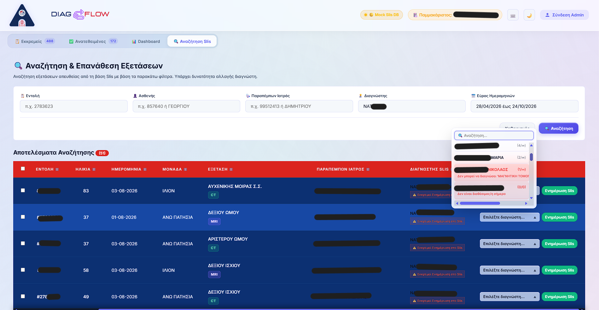 | 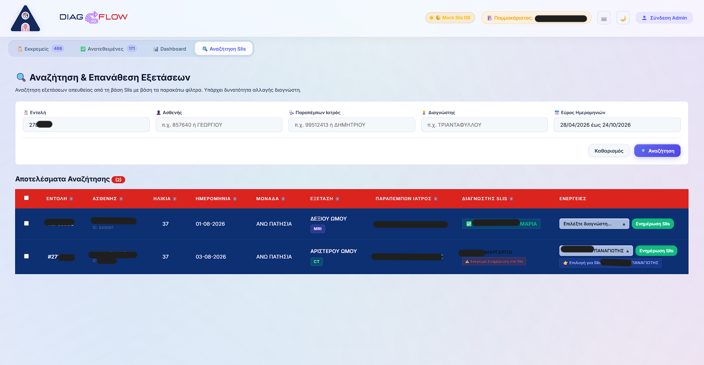 |

</div>

---

## 🔐 Το Admin Panel

Το **Admin Panel** είναι η διαχειριστική περιοχή της εφαρμογής. Εδώ ρυθμίζονται οι κανόνες που χρησιμοποιεί το σύστημα για να παράγει προτάσεις.

> 🔒 Απαιτείται **κωδικός διαχειριστή** για πρόσβαση.

Πρόσβαση: Ανοίξτε το πρόγραμμα περιήγησης και μεταβείτε στο: `http://localhost:8000/admin.html`

---

### Είσοδος στο Admin Panel

Κατά την πρώτη επίσκεψη, εμφανίζεται παράθυρο σύνδεσης. Εισαγάγετε το **username** και **password** του διαχειριστή.

> Αν δεν γνωρίζετε τα διαπιστευτήρια, επικοινωνήστε με τον υπεύθυνο IT.

---

### 🏥 Πρόγραμμα Παμμακαρίστου

Εξετάσεις από το νοσοκομείο **Παμμακαρίστου** ανατίθενται αυτόματα στον **εφημερεύοντα διαγνωστή** της ημέρας.

Εδώ μπορείτε να:
- Ορίσετε το **εβδομαδιαίο πρόγραμμα** on-call (ποιος εφημερεύει κάθε μέρα της εβδομάδας)
- Κάνετε **χειροκίνητη αλλαγή** για συγκεκριμένη ημερομηνία (αν χρειαστεί αλλαγή βάρδιας)

<div align="center">

| Πρόγραμμα Παμμακαρίστου |
|:---:|
| 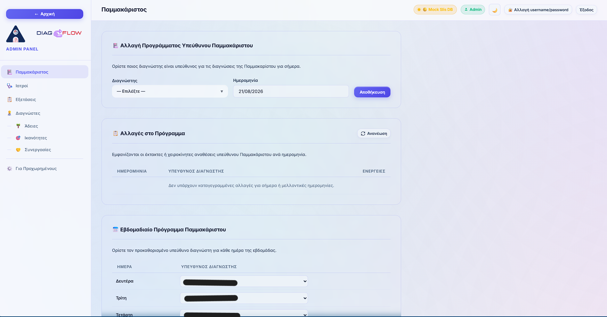 |

</div>

---

### 👨‍⚕️ Διαχείριση Διαγνωστών

Εδώ μπορείτε να δείτε και να επεξεργαστείτε τα στοιχεία κάθε διαγνωστή:

- **Ενεργός/Ανενεργός** — Αν συμμετέχει στη διανομή εξετάσεων
- **Δυνατότητα CT / MRI** — Αν μπορεί να αναλάβει αυτούς τους τύπους
- **Ημερήσια Όρια** — Πόσες εξετάσεις μπορεί να αναλάβει ανά ημέρα (Δευ–Κυρ)
- **Προτιμώμενο Εργαστήριο** — Σε ποιο εργαστήριο εργάζεται κυρίως

> ⚠️ **Σημείωση:** Για να λαμβάνεται υπόψιν κάποιος διαγνώστης για εξετάσεις λ.χ. MRI δεν αρκεί να προσθέσουμε τις αντίστοιχες εξετάσεις στις δεξιότητές του, αλλά και να ενεργοποιήσουμε τη δυνατότητα MRI!

<div align="center">

| Διαχείριση Διαγνωστών |
|:---:|
| 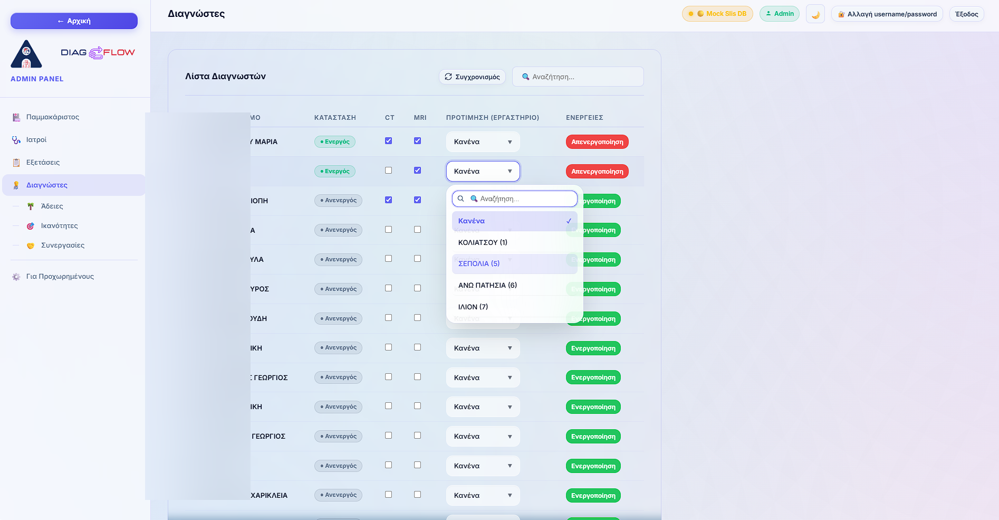 |

</div>

---

### 🌴 Ημερολόγιο Διαθεσιμότητας

Εδώ καταγράφονται οι **άδειες και απουσίες** των διαγνωστών. Ο διαχειριστής μπορεί να:

- Δηλώσει άδεια για συγκεκριμένη ημερομηνία
- Ορίσει εξαίρεση (π.χ. κάποιος δουλεύει εκτός του κανονικού προγράμματός του)

Αν ένας διαγνωστής έχει δηλωμένη άδεια, το σύστημα τον **αφαιρεί αυτόματα** από τις προτάσεις εκείνης της ημέρας.

<div align="center">

| Ημερολόγιο Διαθεσιμότητας |
|:---:|
| 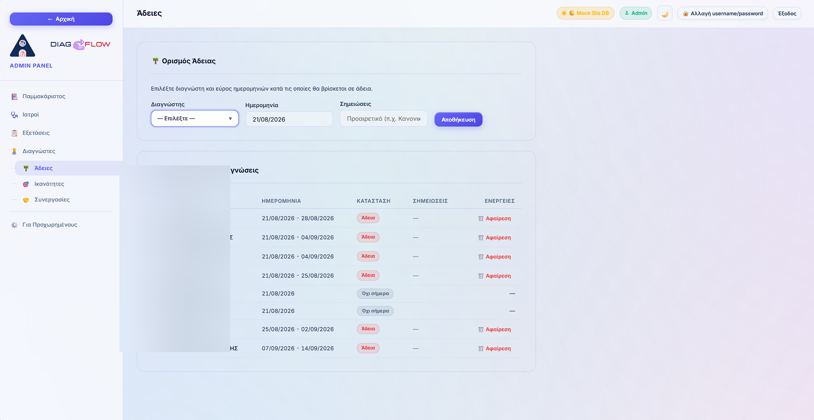 |

</div>

---

### 📋 Κατάλογος Εξετάσεων & Ομαδικές Δεξιότητες

Στην καρτέλα **"📋 Εξετάσεις"** του Admin Panel προβάλλεται ο πλήρης κατάλογος όλων των κωδικών εξετάσεων (Exam Dictionary) ταξινομημένος ανά κατηγορία (CT, MRI, MRA) και ανατομική ομάδα (π.χ. Άνω Άκρα, Κάτω Άκρα, Εγκέφαλος, Θώρακας κ.λπ.).

**Χαρακτηριστικά:**
- **Αναζήτηση:** Άμεσο φιλτράρισμα εξετάσεων πληκτρολογώντας κωδικό ή όνομα εξέτασης.
- **Ομαδική Ανάθεση Δεξιοτήτων:** Επιλέξτε πολλαπλές εξετάσεις μέσω checkbox, επιλέξτε διαγνώστη από τη φλοτέρ μπάρα (floating bar), ορίστε αν πρόκειται για **Προτίμηση** (`✓`), και πατήστε **"🎯 Προσθήκη ως Δεξιότητες"** για μαζική ενημέρωση των ικανοτήτων του διαγνώστη.

<div align="center">

| Κατάλογος Εξετάσεων & Ανατομικές Ομάδες |
|:---:|
| 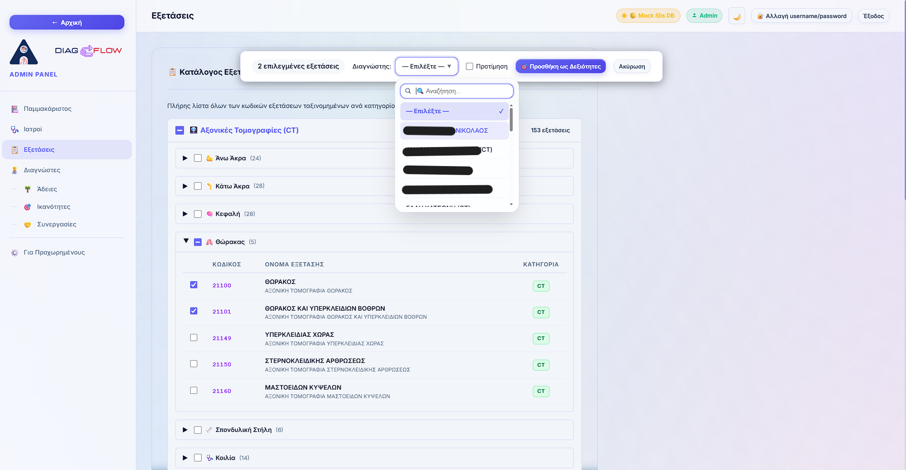 |

</div>

---

### 🎯 Εξειδικεύσεις Διαγνωστών

Η "Μήτρα Εξειδικεύσεων" δείχνει ποιος διαγνωστής **εξειδικεύεται σε ποιους τύπους εξετάσεων**. Σε περίπτωση που κάποιος διαγνώστης προτιμά κάποιες εξετάσεις, μπορούμε να το θέσουμε από εδώ και πλέον θα λαμβάνει επιπλέον βαθμολογία για αυτές τις εξετάσεις. Επίσης, από αυτή την καρτέλα επεξεργαζόμαστε **τα ημερήσια όρια των διαγνωστών ανά ημέρα της εβδομάδας.**

<div align="center">

| Μήτρα Χωρητικότητας & Εξειδικεύσεων (Θολή) | Μήτρα Εξειδικεύσεων (Προτιμήσεις & Αποκλεισμοί) |
|:---:|:---:|
| 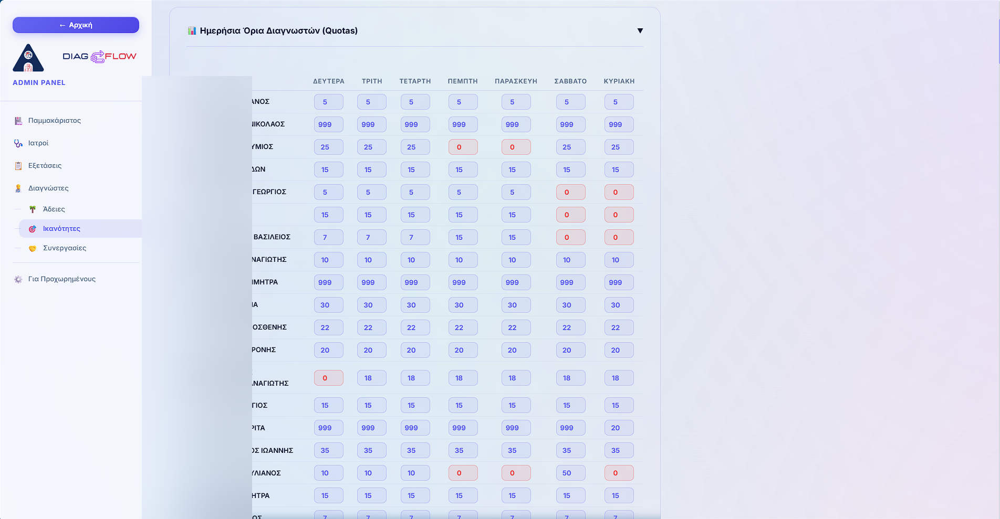 | 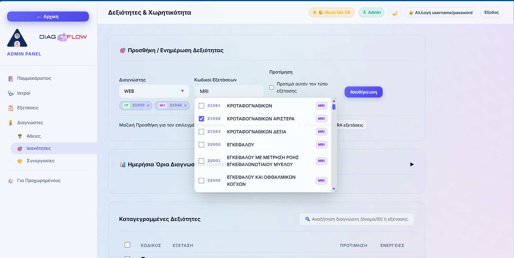 |

| Διαχείριση Μήτρας Εξειδικεύσεων & Φίλτρα |
|:---:|
| 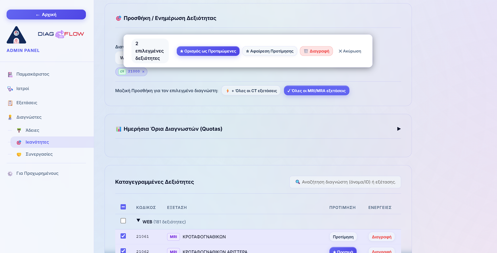 |

</div>

---

### 🤝 Συνεργασίες Γιατρών

Εδώ ορίζονται οι **σχέσεις μεταξύ γιατρών (που παραπέμπουν) και διαγνωστών**:

- **Κανονική συνεργασία** — Ο διαγνωστής προτιμάται για εξετάσεις από αυτόν τον γιατρό (bonus βαθμολογία)
- **Αποκλειστική συνεργασία** — Εξετάσεις από αυτόν τον γιατρό ανατίθενται **αυτόματα** σε αυτόν τον διαγνωστή, χωρίς να χρειαστεί χειροκίνητη επιβεβαίωση

<div align="center">

| Συνεργασίες Γιατρών |
|:---:|
| 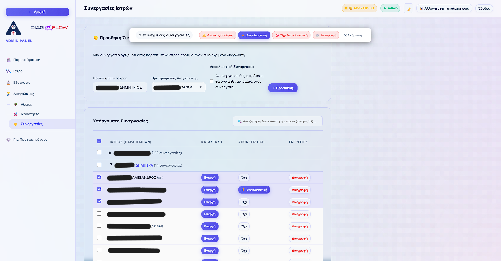 |

</div>


---

### ⚙️ Προχωρημένες Ρυθμίσεις

Η ενότητα **"⚙️ Για Προχωρημένους"** περιλαμβάνει πιο εξειδικευμένες ρυθμίσεις:

**Κανόνες Αυτόματης Δρομολόγησης** — Συγκεκριμένοι κωδικοί εξετάσεων (π.χ. Αρθρογραφίες, Φασματοσκοπίες) ανατίθενται αυτόματα σε συγκεκριμένους εξειδικευμένους διαγνωστές.

**Αποκλειστικά Εργαστήρια** — Κάποιοι διαγνωστές ανήκουν αποκλειστικά σε ένα εργαστήριο και δεν αναλαμβάνουν εξετάσεις από άλλα.

**Όρια CT/MRI** — Εκτός από το γενικό ημερήσιο όριο, μπορεί να υπάρχει ξεχωριστό όριο για CT ή MRI εξετάσεις.

**Βάρη Βαθμολόγησης** — Ρύθμιση του πόσο "σημαντικός" είναι κάθε παράγοντας στην τελική βαθμολογία (π.χ. η συνεργασία με γιατρό vs. το ιστορικό ασθενή).

<div align="center">

| Επεξεργαστής Κανόνων | Αποκλειστικά Εργαστήρια & Χωρητικότητα ανά Modality |
|:---:|:---:|
| 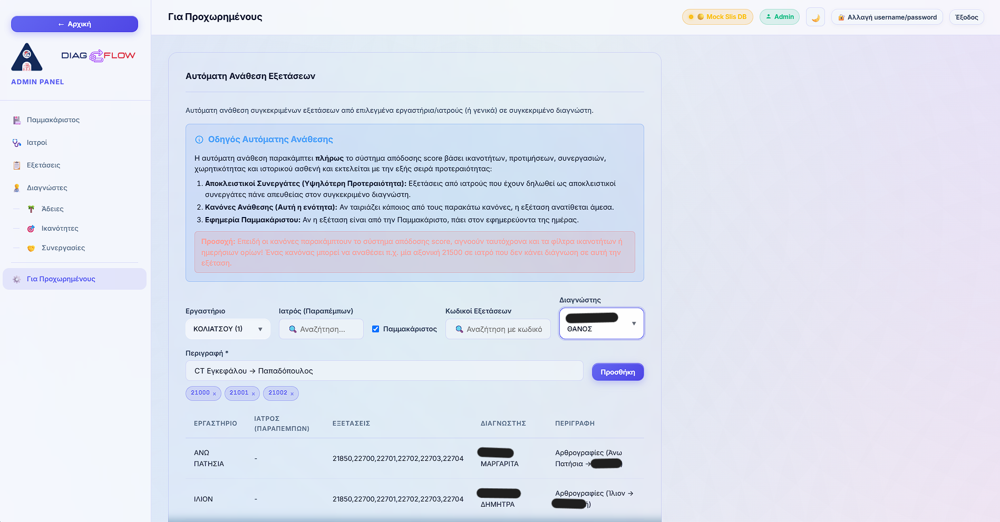 | 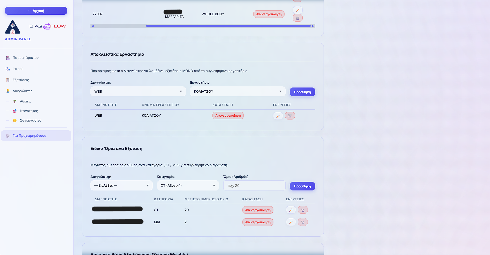 |

| Επεξεργαστής Βαρών Βαθμολόγησης |
|:---:|
| 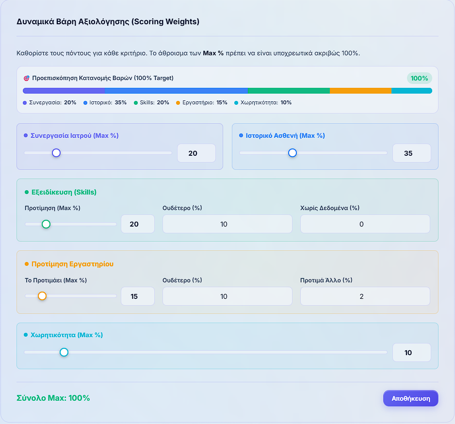 |

</div>

---

## ❓ Συχνές Ερωτήσεις

**Ε: Τι σημαίνει ο αριθμός δίπλα στο όνομα του διαγνωστή (π.χ. `8/15`);**  
Α: Δείχνει τον **σημερινό φόρτο** του διαγνώστη σε σχέση με το μέγιστο ημερήσιο όριό του για τη συγκεκριμένη ημέρα της εβδομάδας (π.χ. 8 ανατεθειμένες εξετάσεις από μέγιστο όριο 15).  
*Τι περιλαμβάνει ο αριθμός;* Ο μετρητής υπολογίζει **όλες τις εξετάσεις της σημερινής ημέρας**, δηλαδή:
1. Τις εξετάσεις που βρίσκονται προσωρινά στην καρτέλα **"✅ Ανατεθειμένες"** και περιμένουν αποστολή.
2. Τις εξετάσεις που έχουν ήδη σταλεί και οριστικοποιηθεί σήμερα στο Slis.  
*Πότε αλλάζει;* Ο αριθμός αυξάνεται άμεσα μόλις επιβεβαιώσετε μια πρόταση (ή γίνει αυτόματη ανάθεση) και μειώνεται αν ακυρώσετε (unassign) μια ανάθεση ή αλλάξετε διαγνώστη.

---

**Ε: Πότε πρέπει να πατάω "Αποστολή στο Slis" (Update Slis);**  
Α: Αφού ελέγξετε και επιβεβαιώσετε τις αναθέσεις των εκκρεμών εξετάσεων, πατάτε **"Αποστολή στο Slis"** (είτε μαζικά για όλες είτε επιλεκτικά για συγκεκριμένες).  
*Γιατί είναι απαραίτητο;*  
- Μέχρι να πατηθεί η αποστολή, οι αναθέσεις είναι καταχωρημένες **μόνο τοπικά στο DiagFlow**.
- Με το πάτημα του κουμπιού, οι αναθέσεις εγγράφονται οριστικά στο κεντρικό σύστημα Slis της Infomed, επιτρέποντας στους διαγνωστικούς σταθμούς και τους ιατρούς να γνωρίζουν άμεσα ποιος έχει αναλάβει τη γνωμάτευση.  
- **Καλό είναι στο τέλος κάθε βάρδιας / ημέρας να μην μένουν εκκρεμότητες στην καρτέλα "✅ Ανατεθειμένες"**, ώστε το κεντρικό σύστημα Slis να είναι 100% συγχρονισμένο.

---

**Ε: Πώς λειτουργεί ο μηδενισμός και τα ημερήσια όρια τα μεσάνυχτα (00:00);**  
Α: Τα μεσάνυχτα (00:00) η εφαρμογή αλλάζει αυτόματα ημερομηνία:
- Ο μετρητής σημερινού φόρτου **ξεκινά αυτόματα από το 0** για τις εξετάσεις της νέας ημέρας.
- Εξετάσεις που ολοκληρώθηκαν και στάλθηκαν στο Slis τις προηγούμενες ημέρες **δεν επιβαρύνουν** το όριο της νέας ημέρας.
- Το σύστημα εφαρμόζει αυτόματα το **όριο της αντίστοιχης ημέρας** της εβδομάδας (π.χ. το όριο της Τρίτης αντί της Δευτέρας), όπως αυτό έχει οριστεί στον πίνακα διαχειριστή.

---

**Ε: Πώς λειτουργούν τα ημερήσια όρια ανά ημέρα της εβδομάδας και τα ειδικά όρια CT / MRI (Modality Quotas);**  
Α: Κάθε διαγνώστης έχει το δικό του πρόγραμμα:
- **Όριο ανά ημέρα (Δευ–Κυρ):** Ορίζει το γενικό ημερήσιο πλαφόν (π.χ. 15 εξετάσεις). Αν τεθεί `0`, ο διαγνώστης θεωρείται ότι δεν εργάζεται τη συγκεκριμένη ημέρα και αποκλείεται αυτόματα. Αν τεθεί `999`, έχει απεριόριστη χωρητικότητα. Αυτά μπορούν να οριστούν από το **Admin Panel -> 🎯 Ικανότητες -> 📊 Ημερήσια Όρια Διαγνωστών (Quotas)**.
- **Ειδικά όρια Modality (CT/MRI):** Ο διαχειριστής μπορεί να ορίσει επιπλέον υπο-όρια (π.χ. συνολικό όριο 15, αλλά μέγιστο 5 CT ή 10 MRI). Η μηχανή κανόνων ελέγχει ταυτόχρονα και τα δύο όρια πριν προτείνει τον διαγνώστη. Αυτά μπορούν να οριστούν από το **Admin Panel -> ⚙️ Για Προχωρημένους -> Ειδικά Όρια ανά Εξέταση**.

---

**Ε: Τι σημαίνει όταν μια πρόταση έχει χαμηλό Score (π.χ. 30–40%) σε σχέση με μία που έχει 85–100%;**  
Α: 
- **Υψηλό Score (>70%):** Ο διαγνώστης συγκεντρώνει ισχυρά πλεονεκτήματα (π.χ. αποκλειστική/ενεργή συνεργασία με τον γιατρό, εξειδίκευση στον κωδικό εξέτασης ή προηγούμενο ιστορικό του ασθενούς). 
- **Χαμηλότερο Score (30–50%):** Δεν βρέθηκε ειδική συνεργασία ή ιστορικό, αλλά ο διαγνώστης προτάθηκε επειδή είναι διαθέσιμος, έχει ελεύθερο ημερήσιο όριο και έχει τη δυνατότητα να εκτελέσει το συγκεκριμένο modality (CT/MRI).

---

**Ε: Τι είναι η 3η καρτέλα "📊 Dashboard" και πώς με βοηθά στην παρακολούθηση της κατανομής;**  
Α: Η καρτέλα **"📊 Dashboard"** παρέχει σε πραγματικό χρόνο ζωντανή επισκόπηση του συνόλου του κέντρου:
- **Κατανομή Modality:** Πόσες εξετάσεις CT, MRI, MRA, US, XRAY έχουν ανατεθεί σήμερα.
- **Μπάρες Προόδου Χωρητικότητας:** Άμεση οπτική ένδειξη για το πόσο κοντά βρίσκεται κάθε διαγνώστης στο ημερήσιο όριό του.
- **Λίστα Εξετάσεων ανά Ιατρό:** Αναλυτική προβολή των κωδικών εντολών (`extracode`) που έχει αναλάβει κάθε ιατρός.

---

**Ε: Πώς λειτουργεί το Ιστορικό Ασθενή (Patient History) στις προτάσεις ανάθεσης;**  
Α: Όταν μια εξέταση φορτώνει στο σύστημα, το DiagFlow ελέγχει αυτόματα αν ο ασθενής έχει διαγνωστεί στο παρελθόν κάποια ίδιου τύπου εξέταση και από ποιον. Εάν εντοπιστεί προηγούμενη εξέταση, ο συγκεκριμένος διαγνώστης λαμβάνει **σημαντικό bonus βαθμολογίας (20%)**, ώστε να προτιμάται ο ιατρός που γνωρίζει ήδη την κλινική εικόνα του ασθενούς, ενισχύοντας τη διαγνωστική συνέχεια.

---

**Ε: Πώς λειτουργούν τα φίλτρα Σχολίων και Ιστορικού στην καρτέλα εκκρεμών;**  
Α: Στο επάνω μέρος της καρτέλας **"📋 Εκκρεμείς"** μπορείτε να επιλέξετε:
- **"Μόνο με σχόλια"**: Φιλτράρει άμεσα τις εξετάσεις που περιέχουν ειδικές παρατηρήσεις ή κλινικά σχόλια από τον παραπέμποντα γιατρό.
- **"Μόνο με ιστορικό"**: Εμφανίζει μόνο εξετάσεις ασθενών που έχουν καταγεγραμμένες προηγούμενες επισκέψεις στο κέντρο.
- **Φίλτρα Τύπου & Εργαστηρίου**: Περιορίζουν τον πίνακα σε συγκεκριμένη κατηγορία (π.χ. μόνο MRI) ή συγκεκριμένο παράρτημα.

---

**Ε: Γιατί το κουμπί "💬 Σχόλιο" εμφανίζεται σε κάποιες εξετάσεις με έντονο κόκκινο χρώμα;**  
Α: Το κουμπί σχολίου γίνεται **κόκκινο** όταν το σύστημα αναγνωρίσει ότι μέσα στο κείμενο των σημειώσεων/σχολίων της εξέτασης αναφέρεται **το όνομα ή το επώνυμο κάποιου διαγνωστή** (π.χ. *"ΝΑ ΤΟ ΔΕΙ Ο Κ. ΜΠΕΡΕΤΗΣ"* ή *"ΠΑΠΟΥΤΣΗ"*).  
*Γιατί γίνεται αυτό;*  
Ο μηχανισμός ανάλυσης κειμένου συγκρίνει αυτόματα το περιεχόμενο των σχολίων με τα ονόματα όλων των ενεργών διαγνωστών. Όταν εντοπιστεί υπόδειξη συγκεκριμένου ιατρού, το κουμπί χρωματίζεται κόκκινο ώστε να εφιστήσει άμεσα την προσοχή της γραμματείας ότι υπάρχει ειδική επιθυμία/οδηγία για τον συγκεκριμένο διαγνωστή.
> ⚠️ **Σημείωση: Αυτό δεν λαμβάνεται υπόψιν για την πρόταση που θα κάνει η εφαρμογή**

---

**Ε: Μπορώ να αλλάξω ή να ακυρώσω μια ανάθεση;**  
Α: 
- **Πριν σταλεί στο Slis:** Από την καρτέλα **"✅ Ανατεθειμένες"**, μπορείτε να πατήσετε το κουμπί ακύρωσης (Unassign) σε μια γραμμή ή να επιλέξετε πολλές εξετάσεις και να πατήσετε μαζική ακύρωση. Η εξέταση επιστρέφει αμέσως στις **"📋 Εκκρεμείς"** και ο μετρητής του διαγνώστη μειώνεται.
- **Μετά την αποστολή στο Slis:** Μεταβείτε στην καρτέλα **"🔍 Αναζήτηση Slis"**, αναζητήστε την εξέταση (π.χ. με κωδικό εντολής ή όνομα ασθενή), επιλέξτε τον νέο διαγνώστη από το μενού και πατήστε **"Αλλαγή"**. Η ενημέρωση γίνεται απευθείας στο Slis σε πραγματικό χρόνο.

---

**Ε: Γιατί κάποιες εξετάσεις εμφανίζονται ήδη στην καρτέλα "✅ Ανατεθειμένες" χωρίς να έχω πατήσει επιβεβαίωση;**  
Α: Πρόκειται για **Αυτόματες Αναθέσεις (Stage 0 Auto-Assignments)**. Ενεργοποιούνται αυτόματα κατά την ανανέωση των εξετάσεων όταν:
1. Υπάρχει **αποκλειστική συνεργασία** του παραπέμποντος ιατρού με συγκεκριμένο διαγνώστη.
2. Η εξέταση προέρχεται από το νοσοκομείο **Παμμακάριστος** και ανατίθεται στον εφημερεύοντα της ημέρας.
3. Υπάρχει ενεργός **κανόνας αυτόματης δρομολόγησης** για συγκεκριμένο κωδικό εξέτασης (π.χ. Αρθρογραφίες, Φασματοσκοπίες).  
*Οι αυτόματες αναθέσεις φέρουν την ένδειξη `AUTO` και περνώντας το ποντίκι πάνω από την ετικέτα εμφανίζεται ο ακριβής λόγος.*

---

**Ε: Τι συμβαίνει όταν μια εντολή (`extracode`) περιλαμβάνει πολλαπλές εξετάσεις για τον ίδιο ασθενή;**  
Α: Η μηχανή κανόνων εφαρμόζει **ομαδοποίηση βάσει εντολής**. Αν ένας ασθενής έχει παραπεμφθεί π.χ. για CT Θώρακος και CT Κοιλίας στην ίδια επίσκεψη, το σύστημα εξασφαλίζει ότι θα προταθεί **ο ίδιος διαγνώστης για όλες τις εξετάσεις της εντολής**, διασφαλίζοντας την ιατρική συνέχεια και συνοχή των γνωματεύσεων.

---

**Ε: Τι γίνεται αν δύο χρήστες στη γραμματεία αναθέσουν την ίδια εξέταση ταυτόχρονα από διαφορετικούς υπολογιστές;**  
Α: Το DiagFlow ενσωματώνει μηχανισμό **Optimistic Locking (Προστασία Ταυτόχρονης Ενημέρωσης)**. Αν ένας άλλος χρήστης προλάβει να στείλει την ανάθεση στο Slis, το σύστημα δεν επιτρέπει overwrite και εμφανίζει ενημερωτικό μήνυμα στον χρήστη που προσπαθεί να αναθέσει δεύτερος ότι η εξέταση έχει ήδη ανατεθεί από άλλον συνάδελφο.

---

**Ε: Τι συμβαίνει αν μια εξέταση ακυρωθεί την τελευταία στιγμή (π.χ. λόγω κλειστοφοβίας, αλλεργίας κ.λπ.);**  
Α: Εάν μια εξέταση δεν πραγματοποιηθεί τελικά και ακυρωθεί/διαγραφεί από το κεντρικό σύστημα Slis:
- **Κατά την «Αποστολή στο Slis»:** Το DiagFlow ελέγχει σε πραγματικό χρόνο αν η εξέταση υπάρχει ακόμα ενεργή στο κεντρικό Slis. Αν διαπιστώσει ότι έχει ακυρωθεί ή διαγραφεί, την αφαιρεί αυτόματα από τις τοπικές αναθέσεις και ενημερώνει τη γραμματεία με σχετικό μήνυμα, χωρίς να διακόπτεται η διαδικασία για τις υπόλοιπες εξετάσεις.
- **Χειροκίνητη Ακύρωση στο DiagFlow:** Εφόσον γνωρίζετε εκ των προτέρων ότι η εξέταση ακυρώθηκε, μπορείτε να πατήσετε απευθείας το κουμπί **Αφαίρεση** στην καρτέλα **"✅ Ανατεθειμένες"** ώστε να αποδεσμευτεί άμεσα.

---

**Ε: Τι γίνεται αν δεν υπάρχει κανένας διαθέσιμος διαγνώστης για μια εξέταση;**  
Α: Το σύστημα εμφανίζει σχετική ειδοποίηση. Μπορείτε να ανοίξετε το παράθυρο **"Εναλλακτικοί" (Alternatives)**, να δείτε τους λόγους αποκλεισμού των υπολοίπων ιατρών (π.χ. συμπλήρωση ορίου, άδεια, έλλειψη εξειδίκευσης) και, εάν κριθεί απαραίτητο, να επιλέξετε χειροκίνητα οποιονδήποτε ιατρό παρακάμπτοντας τον κανόνα (Manual Override).

---

**Ε: Πόσο συχνά πρέπει να πατάω το κουμπί «Ανανέωση» (Refresh);**  
Α: Μπορείτε να πατάτε «Ανανέωση» οποιαδήποτε στιγμή κατά τη διάρκεια της βάρδιας όταν γνωρίζετε ότι έχουν καταχωρηθεί νέες εξετάσεις στο Slis (το σύστημα αντλεί εξετάσεις των τελευταίων 3 ημερών). Κάθε φορά που πατάτε ανανέωση, το DiagFlow εκτελεί άμεσα και τις αυτόματες αναθέσεις για τις νέες εξετάσεις.

---

**Ε: Αν κλείσει η εφαρμογή ή γίνει επανεκκίνηση του υπολογιστή, θα χαθούν οι προσωρινές αναθέσεις μου;**  
Α: **Όχι.** Όλες οι τοπικές αναθέσεις, οι ρυθμίσεις διαχειριστή και τα ημερήσια όρια αποθηκεύονται απευθείας στη βάση δεδομένων `diagflow.db`. Ανοίγοντας ξανά την εφαρμογή, όλες οι αναθέσεις της καρτέλας **«✅ Ανατεθειμένες»** παραμένουν στη θέση τους.

---

<div align="center">
  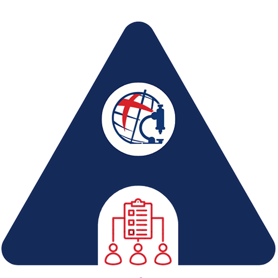
  &nbsp;&nbsp;&nbsp;&nbsp;
  
  &nbsp;&nbsp;&nbsp;&nbsp;
  
</div>